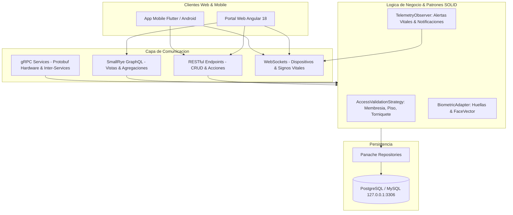

# Plan Arquitectonico Integral: Biometria Dual, Portales Web/Mobile, Permisos por Pisos/Torniquetes, gRPC, GraphQL y WebSockets

## 1. Vision & Alcance del Sistema
Construir una solucion integral de control de acceso biometrico y gestion de instalaciones de alta disponibilidad con:
- **Biometria Dual (Dactilar y Facial):** Registro y validacion de 2 huellas dactilares (`huella1`, `huella2`) + vector facial 128D (`faceVector`) tanto para **Clientes** como para **Empleados**.
- **Perfiles y Portales para Clientes (Web & Mobile):**
  - Generacion y validacion de Credencial QR dinamica y reconocimiento facial.
  - Consulta de estado de membresia, historial de pagos, deudas y notificaciones de cobranza.
  - Streaming de signos vitales (BPM, SpO2, temperatura corporal) enviados por wearables/app mobile en tiempo real.
- **Perfiles para Empleados:**
  - Credencial QR y acceso facial.
  - Ficha laboral, historial de marcajes de ingreso y salida (jornada laboral).
- **Matriz de Permisos por Pisos y Torniquetes:**
  - Asignacion granular de pisos y torniquetes permitidos para Clientes, Visitantes y Empleados.
  - Reglas de denegacion automatica por: falta de pago / membresia vencida, piso no autorizado o torniquete fuera de horario.
- **Auditoria de Accesos:**
  - Historial detallado de accesos concedidos e intentos indebidos/denegados con motivo formal.
- **Login y Permisos por Modulos:**
  - Control de acceso basado en roles (RBAC) para la plataforma web y mobile.
- **Protocolos de Comunicacion:**
  - **RESTful Estricto:** CRUDs de Pisos, Dispositivos, Clientes, Visitantes, Empleados.
  - **gRPC:** Comunicacion de alta velocidad con hardware de torniquetes y validadores biometricos.
  - **GraphQL (SmallRye):** Consultas agregadas de alto rendimiento para perfiles y vistas detalladas.
  - **WebSockets:** Streaming de estado ONLINE de torniquetes y telemetria de signos vitales.

---

## 2. Diseno Arquitectonico y Patrones de Diseno



### Patrones de Diseno Implementados
1. **Strategy Pattern (`AccessValidationStrategy`):**
   - Reglas desacopladas para evaluar si se concede el paso:
     - `PaymentStatusStrategy`: Valida deudas o membresias vencidas.
     - `FloorPermissionStrategy`: Valida que el piso del torniquete este en la lista de pisos autorizados.
     - `TimeWindowStrategy`: Valida horarios laborales en empleados y citas activas en visitantes.
2. **Observer / Pub-Sub Pattern:**
   - Emision reactiva de eventos cuando ingresa un cliente/empleado, cuando un torniquete cambia a ONLINE/OFFLINE, o cuando los signos vitales superan umbrales criticos.
3. **Adapter Pattern (`HardwareRelayAdapter` & `BiometricAdapter`):**
   - Aisla las llamadas fisicas al hardware (pulso GPIO / IP relay / protocolo gRPC).
4. **Repository Pattern:**
   - Abstraccion de persistencia con Quarkus Panache.

---

## 3. Especificacion de Endpoints & Contratos

### A. RESTful APIs
- **Autenticacion & RBAC:**
  - `POST /api/v1/auth/login`: Autenticacion con JWT y retorno de roles/permisos por modulo (`PISOS`, `TORNIQUETES`, `CLIENTES`, `EMPLEADOS`, `VISITANTES`, `MONITOR_SALUD`).
- **CRUDs Completos:**
  - `Pisos`: `/api/v1/pisos` (`GET`, `POST`, `PUT`, `DELETE`).
  - `Dispositivos / Torniquetes`: `/api/v1/dispositivos` (`GET`, `POST`, `PUT`, `DELETE`, `POST /{id}/abrir`).
  - `Clientes`: `/api/v1/clientes` (`GET`, `POST`, `PUT`, `DELETE`).
  - `Visitantes`: `/api/v1/visitantes` (`GET`, `POST`, `PUT`, `DELETE`).
  - `Empleados`: `/api/v1/empleados` (`GET`, `POST`, `PUT`, `DELETE`).
- **Perfil de Usuario (Cliente Web/Mobile):**
  - `GET /api/v1/cliente/perfil/{id}`: Datos personales, balance de deuda y vigencia.
  - `GET /api/v1/cliente/{id}/qr`: Token QR temporal firmado para apertura de torniquete.
  - `GET /api/v1/cliente/{id}/finanzas`: Detalle de pagos, saldos pendientes y notificaciones de cobro.
  - `POST /api/v1/cliente/{id}/pagar`: Registro de pago en linea con conciliacion automatica.
  - `POST /api/v1/telemetria/signos-vitales`: Ingestion de telemetria desde la app mobile (BPM, SpO2, Temp).
- **Perfil de Usuario (Empleado Web/Mobile):**
  - `GET /api/v1/empleado/perfil/{id}`: Ficha de empleado, gerencia, tipo de contrato.
  - `GET /api/v1/empleado/{id}/qr`: QR corporativo de acceso.
  - `GET /api/v1/empleado/{id}/asistencias`: Historial de marcajes de ingreso y salida.
- **Auditoria de Accesos:**
  - `GET /api/v1/acceso/historial/permitidos`: Listado paginado de accesos concedidos.
  - `GET /api/v1/acceso/historial/denegados`: Listado de accesos denegados clasificados por motivo (FALTA_DE_PAGO, PISO_NO_AUTORIZADO, BIOMETRIA_INVALIDA).

### B. gRPC Services (`acceso.proto`)
- `ValidarAcceso(AccesoRequest) returns (AccesoResponse)`
- `AccionarTorniquete(TorniqueteAccionRequest) returns (TorniqueteAccionResponse)`
- `ReportarHeartbeat(DispositivoStatusRequest) returns (DispositivoStatusResponse)`

### C. GraphQL Queries & Mutations (SmallRye)
- `clienteDetalleCompleto(id: ID!): ClienteDetallePayload`: Retorna perfil, huellas/foto, membresia, deudas, ultimos 10 accesos y signos vitales en una sola llamada.
- `dispositivosPorPisoConEstado(pisoId: ID!): [DispositivoStatus]`: Retorna torniquetes vinculados al piso con estatus online.

### D. WebSockets
- `/ws/dispositivos`: Estado ONLINE/OFFLINE en vivo de cada torniquete.
- `/ws/vital-signs`: Emision en tiempo real de telemetria cardiaca y alertas de salud.
- `/ws/acceso`: Transmision de marcajes en vivo a la consola de seguridad/recepcion.

---

## 4. Lista de Tareas de Ejecucion (Atomic Checklist)

### Fase 1: Arquitectura Base y Backend (Quarkus)
- [ ] **T1.1:** Anadir dependencias en `control_server/pom.xml`: `quarkus-grpc` y `quarkus-smallrye-graphql`.
- [ ] **T1.2:** Crear definicion protobuf `src/main/proto/acceso.proto` para comunicacion inter-servicios y torniquetes.
- [ ] **T1.3:** Implementar `AccesoHardwareGrpcService.java` para resolver validaciones y pulsos por gRPC.
- [ ] **T1.4:** Actualizar entidad `Dispositivo.java` para asociar `@ManyToOne private Piso piso;`.
- [ ] **T1.5:** Implementar `AccessValidationStrategy.java` con reglas para membresia, pisos permitidos y biometria dual.
- [ ] **T1.6:** Implementar `ControlAccesoGraphQLApi.java` con SmallRye GraphQL para vistas de detalle agregadas de Clientes y Empleados.
- [ ] **T1.7:** Robustecer `AccesoResource.java` con endpoints para filtros de accesos permitidos y denegados (`/historial/permitidos`, `/historial/denegados`).
- [ ] **T1.8:** Implementar endpoints de perfil para Cliente y Empleado (QR dinamico, deudas, pagos, asistencias in/out).
- [ ] **T1.9:** Implementar `DispositivosWebSocketEndpoint.java` para difusion de torniquetes online.

### Fase 2: Servicios y Modelos Frontend (Angular 18)
- [ ] **T2.1:** Normalizar `baseUrl` relativos en todos los servicios de `control_web/src/main/web/src/app/shared/`.
- [ ] **T2.2:** Crear `cliente.model.ts` y `cliente.service.ts` con soporte de biometria dual (`huella1`, `huella2`, `faceVector`) y finanzas.
- [ ] **T2.3:** Crear servicio reactivo `dispositivos-stream.service.ts` para suscripcion WebSocket al estado online de torniquetes.
- [ ] **T2.4:** Crear servicio `vital-signs-stream.service.ts` para recepcion de telemetria en tiempo real y alertas de salud.
- [ ] **T2.5:** Crear servicio `acceso-auditoria.service.ts` para consultas de accesos concedidos y denegados.

### Fase 3: Modulos y Vistas CRUD Frontend
- [ ] **T3.1:** Implementar componentes faltantes de Clientes: `cliente-list`, `cliente-details`, `editar-cliente`.
- [ ] **T3.2:** Integrar `BiometricCaptureComponent` en `crear-cliente` y `crear-empleado` asegurando captura de ambas huellas y vector facial.
- [ ] **T3.3:** Modernizar modulo `dispositivo`: selector de piso, boton de prueba de apertura con toast y badge de estado online por WebSocket.
- [ ] **T3.4:** Modernizar modulo `piso`: listado de dispositivos asociados y asignacion a clientes/empleados.
- [ ] **T3.5:** Actualizar modulo `empleado`: visualizacion de biometria dual, selector de pisos autorizados y reporte de ingresos/salidas.
- [ ] **T3.6:** Actualizar modulo `visitante`: generacion y descarga de credencial QR temporal con expiracion.
- [ ] **T3.7:** Implementar vista de Auditoria de Accesos: tabs de "Permitidos" y "Denegados / Indebidos" con filtros por fecha y motivo.
- [ ] **T3.8:** Actualizar `app.routing.module.ts` y menu lateral (`left-menu.component.html`) con las nuevas rutas y control de permisos por modulo.

### Fase 4: Pruebas y Verificacion
- [ ] **T4.1:** Ejecutar suite de pruebas unitarias y de integracion en Backend con `mvn test`.
- [ ] **T4.2:** Compilar frontend Angular sin errores de TypeScript con `npm run build`.
- [ ] **T4.3:** Validacion manual integral del ciclo E2E en contenedores Docker (creacion, apertura de torniquete, streaming de signos vitales, consulta GraphQL).

---

## 5. Plan de Verificacion

### Pruebas Automatizadas
```bash
# Backend compilation & tests
mvn clean test

# Frontend compilation
cd control_web/src/main/web && npm run build
```

### Pruebas Manuales
1. **Biometria Dual:** Registrar cliente y empleado con 2 huellas y rostro; verificar persistencia en base de datos.
2. **Denegacion por Falta de Pago:** Simular cliente con membresia VENCIDA y verificar que el intento se registre en `/historial/denegados` con bloqueo de apertura.
3. **Permisos de Pisos:** Intentar validar acceso a un torniquete en un piso no asignado al empleado/cliente y verificar denegacion.
4. **WebSocket & Torniquetes Online:** Abrir consola web, verificar cambio de estado en vivo de los dispositivos.
5. **Telemetria de Salud:** Enviar pulso de telemetria anomala desde REST/WebSocket y comprobar toast de alerta en frontend.
